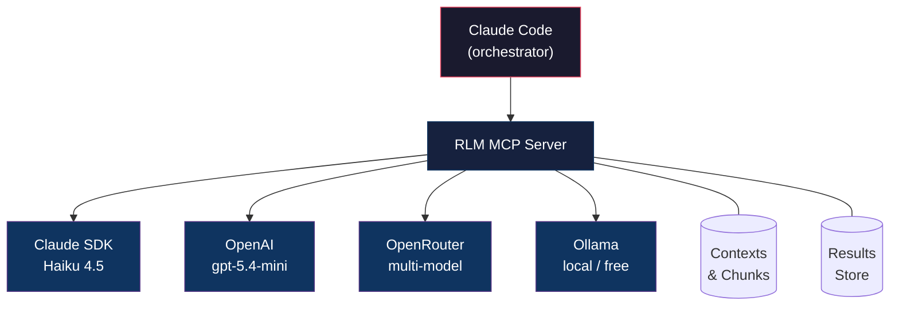
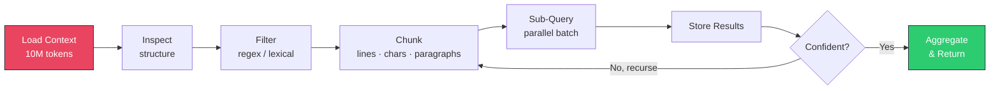

<div align="center">

# RLM

**Your LLM sees 200K tokens. Your codebase is 10 million.**<br>
**The answer isn't a bigger context window.**

[](https://python.org)
[](LICENSE)
[](https://modelcontextprotocol.io)
[](https://github.com/arkaigrowth/rlm/releases)

[Quick Start](#quick-start) · [Demo](#demo) · [How It Works](#how-it-works) · [Tools](#tools) · [Providers](#providers) · [Credits](#credits)

</div>

---

> **Fork notice.** This is a fork of [Richard White's rlm](https://github.com/richardwhiteii/rlm) (MIT), which built the original MCP server. This fork adds OpenRouter and hosted-model providers, a Keychain-backed launcher, a sandbox import blocklist, an idle-timeout watchdog, a setup script, and a rewritten skill. See [Credits](#credits) and [CHANGES.md](CHANGES.md) for the exact split.

## The Core Idea

RLM is an MCP server that implements **Recursive Language Model** patterns from [MIT research](https://arxiv.org/abs/2512.24601) by Tian Jin et al. Instead of stuffing massive contexts into your prompt and hoping for the best, RLM treats context as an **external variable**, loading, chunking, and querying it recursively while keeping your main context window clean.

```
You say:  "Analyze this 2MB log file for errors"
Claude:    Uses RLM tools behind the scenes
You get:  "Found 3 error patterns: database timeouts (47), auth failures (23)..."
```

You never call RLM tools directly. Claude reaches for them when it needs to.

---

## Why Not Just Read the File?

| Approach | What Happens |
|----------|-------------|
| Paste 2MB into prompt | Context window overflow. Truncated results. High cost. |
| Read first 2000 lines | Miss everything after line 2000. |
| Summarize then query | Lossy compression. Details vanish. |
| **RLM** | Full content stays external. Query any part. Sub-LLMs analyze chunks in parallel. Nothing lost. |

The key insight from the [paper](https://arxiv.org/abs/2512.24601): **context is data, not prompt**. Treat it like a database, not a conversation.

---

## Quick Start

### Install

```bash
git clone https://github.com/arkaigrowth/rlm.git
cd rlm
uv sync
```

### Setup (Recommended)

The setup script configures Claude Code, Claude Desktop, or both in one step:

```bash
./scripts/setup.sh --all      # both Claude Code and Claude Desktop
./scripts/setup.sh --code     # Claude Code only
./scripts/setup.sh --desktop  # Claude Desktop only
./scripts/setup.sh --check    # show current status
```

The script:
- Adds the RLM MCP server entry to each platform's config
- Symlinks the skill to `~/.claude/skills/rlm` (prevents drift between global skill and repo)
- Ensures `run_rlm.sh` is executable and the venv is ready

### Manual Configuration

<details>
<summary><strong>Claude Code</strong></summary>

The setup script adds this to `~/.claude/settings.json`:

```json
{
  "mcpServers": {
    "rlm": {
      "command": "/path/to/rlm/run_rlm.sh",
      "args": []
    }
  }
}
```

Or add it manually with the CLI:
```bash
claude mcp add rlm /path/to/rlm/run_rlm.sh
```

</details>

<details>
<summary><strong>Claude Desktop</strong></summary>

The setup script adds this to `~/Library/Application Support/Claude/claude_desktop_config.json`:

```json
{
  "mcpServers": {
    "rlm": {
      "command": "/path/to/rlm/run_rlm.sh",
      "args": []
    }
  }
}
```

Restart Claude Desktop after adding.

</details>

> `run_rlm.sh` handles API key loading via macOS Keychain (items `rlm-openrouter` or `openclaw-openrouter`), falling back to environment variables. See `docs/keychain-env-contract.md` for details.

### Verify

Ask Claude to analyze any large file. If RLM is connected, it will use the tools automatically.

---

## How It Works

<details>
<summary><strong>Architecture</strong></summary>



</details>

<details>
<summary><strong>Processing Pipeline</strong></summary>



</details>

**The pattern is always the same:**

1. **Load**: content becomes an external variable (stays out of your prompt)
2. **Inspect**: understand structure without reading everything
3. **Filter**: narrow the search space with regex before spending tokens
4. **Chunk**: split strategically by lines, characters, or paragraphs
5. **Sub-query**: ask focused questions of each chunk via sub-LLMs
6. **Aggregate**: combine results, resolve conflicts, report gaps

---

## Tools

> These are used by Claude internally. You don't call them, you just ask Claude to analyze large files.

| Tool | Purpose |
|------|---------|
| `rlm_auto_analyze` | **One-step analysis**: detects type, chunks, queries automatically |
| `rlm_load_context` | Load content as external variable |
| `rlm_inspect_context` | Get structure info without loading into prompt |
| `rlm_chunk_context` | Split by lines, characters, or paragraphs |
| `rlm_get_chunk` | Retrieve a specific chunk |
| `rlm_filter_context` | Regex filtering (keep or remove matching lines) |
| `rlm_exec` | Run Python against loaded context (sandboxed) |
| `rlm_sub_query` | Sub-LLM call on a chunk |
| `rlm_sub_query_batch` | Process multiple chunks in parallel |
| `rlm_store_result` | Store results for aggregation |
| `rlm_get_results` | Retrieve stored results |
| `rlm_list_contexts` | List all loaded contexts |

### One-Step Analysis

For most use cases, `rlm_auto_analyze` handles everything:

```python
rlm_auto_analyze(
    name="my_file",
    content=file_content,
    goal="find_bugs"  # or: summarize, extract_structure, security_audit, answer:<question>
)
```

It detects content type (Python, JSON, logs, prose), selects the right chunking strategy, adapts the query, runs parallel sub-queries, and returns aggregated results.

### Programmatic Analysis

For deterministic extraction (regex, counting, parsing), `rlm_exec` runs Python directly against a loaded context:

```python
rlm_exec(
    code="""
import re
amounts = re.findall(r'\\$[\\d,]+', context)
result = {'count': len(amounts), 'sample': amounts[:5]}
""",
    context_name="bill"
)
```

Pre-imported: `re`, `json`, `collections`. Runs in a subprocess sandbox with timeout enforcement.

**When to use which:**

| Task | Tool | Why |
|------|------|-----|
| Extract dates, IDs, amounts | `rlm_exec` | Regex is deterministic and fast |
| Find security vulnerabilities | `rlm_sub_query` | Requires reasoning |
| Parse JSON/XML structure | `rlm_exec` | Standard libraries work |
| Summarize themes or tone | `rlm_sub_query` | Needs language understanding |
| Count patterns | `rlm_exec` | Simple computation |
| Answer "why did X happen?" | `rlm_sub_query` | Requires inference |

---

## Providers

Sub-queries are processed by lightweight sub-LLMs. Pick the right one for your use case:

| Provider | Default Model | Cost | Recursive Tool Calls | Best For |
|----------|--------------|------|---------------------|----------|
| `openrouter` | openai/gpt-5.4-mini | API | **Yes** | **Recommended hosted default** |
| `openai` | gpt-5.4-mini | API | Yes | Direct OpenAI, recursion |
| `ollama` | auto-detected | **Free** | Yes | Local inference, zero cost |
| `claude-sdk` | Haiku 4.5 | Subscription | **No**, single-turn only | Last-resort fallback when no API keys available |

`provider="auto"` prefers `openrouter`, then `ollama`, then `openai` for both simple and recursive calls. `claude-sdk` is only used as a last-resort fallback for non-recursive single-turn work. It does **not** support recursive tool-calling (each call spawns a full CLI subprocess, making it too slow and expensive for recursion).

### Recursive Sub-Queries

The `max_depth` parameter enables hierarchical decomposition:

```python
rlm_sub_query(
    query="Find all security vulnerabilities",
    context_name="codebase",
    chunk_index=0,
    provider="ollama",
    max_depth=1  # Sub-LLM gets RLM tools and can further decompose
)
```

When `max_depth > 0`, the sub-LLM receives RLM tools in its own context and can chunk, filter, and sub-query recursively. Each level decrements the depth until the limit is reached. Responses include recursion metadata: `depth_reached` and `call_trace`.

> Keep `max_depth` shallow (0 or 1). Deeper trees rarely improve results and can escalate costs.

### Provider Setup

<details>
<summary><strong>Ollama (free local inference)</strong></summary>

```bash
# Install Ollama and pull a model
ollama pull gemma3:27b
```

Add to your MCP config env:
```json
"env": {
    "RLM_DATA_DIR": "/Users/you/.rlm-data",
    "OLLAMA_URL": "http://localhost:11434"
}
```

```python
rlm_sub_query_batch(
    query="Extract key points",
    context_name="my_doc",
    chunk_indices=[0, 1, 2, 3],
    provider="ollama",
    concurrency=4
)
```

</details>

<details>
<summary><strong>OpenAI (direct)</strong></summary>

```bash
export OPENAI_API_KEY="your_key"
```

```python
rlm_sub_query_batch(
    query="Extract key findings",
    context_name="my_doc",
    chunk_indices=[0, 1, 2, 3],
    provider="openai",
    model="gpt-5.4-mini",
    max_depth=1
)
```

</details>

<details>
<summary><strong>OpenRouter (multi-model)</strong></summary>

```bash
export OPENROUTER_API_KEY="your_key"
```

```python
rlm_sub_query(
    query="Find security issues",
    context_name="codebase",
    chunk_index=0,
    provider="openrouter",
    model="google/gemini-2.5-flash"  # or any OpenRouter model
)
```

</details>

---

## Auto-Detection

Teach Claude to reach for RLM tools automatically, no manual invocation needed.

**1. CLAUDE.md Integration**: Copy `CLAUDE.md.example` to your project's `CLAUDE.md` (or `~/.claude/CLAUDE.md` for global).

**2. Hook Installation**: Auto-suggests RLM when reading files >25KB:
```bash
cp -r .claude/hooks/ /path/to/your-project/.claude/hooks/
```

**3. Skill Reference**: Comprehensive operational guidance:
```bash
cp -r skills/ /path/to/your-project/skills/
```

The skill system includes **budgets, guardrails, query patterns, and fail-fast contracts**, explicit controls for recursive analysis. See `skills/rlm/SKILL.md` for the full operational profile.

---

## Test Corpus

The repository supports testing with the **Encyclopedia Britannica, 11th Edition** (1910-1911) from Project Gutenberg, 11MB and about 2M tokens.

```bash
# Download the test corpus
./scripts/download-encyclopedia.sh
```

```python
content = open("docs/encyclopedia/merged_encyclopedia.txt").read()
rlm_load_context(name="encyclopedia", content=content)
rlm_inspect_context(name="encyclopedia")
# → 11MB, 184K lines, ~2M tokens

rlm_chunk_context(name="encyclopedia", strategy="paragraphs", size=30)
rlm_sub_query_batch(
    query="Summarize the main topics in this section",
    context_name="encyclopedia",
    chunk_indices=[0, 50, 100, 150],
    provider="ollama"  # Free
)
```

| Metric | Value |
|--------|-------|
| File size | 11 MB |
| Lines | 184,000 |
| Tokens | ~2M |
| Cost | $0 (Ollama) or ~$1.60 (Haiku) |

---

## Data Storage

```
$RLM_DATA_DIR/
├── contexts/     # Raw contexts (.txt + .meta.json)
├── chunks/       # Chunked versions (cached by context)
└── results/      # Stored sub-call results (.jsonl)
```

Contexts persist across sessions. Chunked data is cached for reuse.

---

## Contributing

```bash
git clone https://github.com/arkaigrowth/rlm.git
cd rlm
uv sync --dev
pytest
```

Use Claude Code to explore the codebase:

```
Read src/rlm_mcp_server.py and list all RLM tools with their parameters.
```

```
How does the recursive sub-query system work? Walk me through _call_ollama.
```

```
How would I add a new provider (e.g., Gemini direct API)?
```

---

## Credits

This repository is a fork of [Richard White's RLM](https://github.com/richardwhiteii/rlm), an early MCP server implementing recursive language model patterns. Richard wrote the original server (`src/rlm_mcp_server.py`: context loading, chunking, filtering, sub-queries, `rlm_exec`, `rlm_auto_analyze`), the auto-interception hook, the first skill, and the original README. His MIT notice is preserved in [LICENSE](LICENSE) and his commits remain in this repository's history.

Alex Kamysz's additions on top of that base (details and dates in [CHANGES.md](CHANGES.md)):

- OpenRouter and OpenAI hosted providers, provider auto-selection, GPT-5.4-mini defaults
- Keychain-backed secret loading (`run_rlm.sh`, `scripts/lib/keychain_env.sh`, `docs/keychain-env-contract.md`)
- import blocklist for the `rlm_exec` sandbox and an idle-timeout watchdog against zombie MCP processes
- Claude SDK hardening, Ollama model-resolution fix, `scripts/setup.sh` for Claude Code and Claude Desktop
- a rewritten cross-agent skill (`skills/rlm/`) with budgets, recursion limits, and query patterns

Based on research by **Tian Jin et al.** at MIT:
> [Recursive Language Models](https://arxiv.org/abs/2512.24601) (2025). Introduced the paradigm of treating LLM context as an external variable and using recursive sub-model calls for unbounded context processing.

Encyclopedia Britannica test corpus from [Project Gutenberg](https://www.gutenberg.org/). Public domain.

---

## License

[MIT](LICENSE). Original work Copyright (c) 2025 Richard White; modifications Copyright (c) 2026 Alex Kamysz. Use it, fork it, ship it.

---

<div align="center">

**[arkaigrowth](https://github.com/arkaigrowth)** · [Report Issues](https://github.com/arkaigrowth/rlm/issues) · [Read the Paper](https://arxiv.org/abs/2512.24601)

</div>
